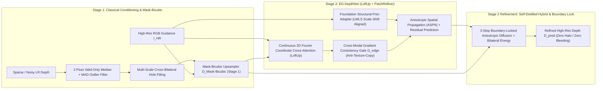

 # Edge-Preserving Depth Map Upsampling and Refinement (ProbID - P4)

An intelligent, edge-aware depth reconstruction and super-resolution framework built for **Problem Statement 4 (ProbID - P4)**. Transforms sparse, noisy, or low-resolution depth maps ($2\times, 4\times, 8\times$) into dense, high-resolution depth representations while sharply preserving geometric object boundaries and suppressing RGB texture-copying artifacts.

---

## Key Architectural Innovations (PatchRefiner + LoftUp Two-Stage Hybrid)



1. **Stage 1 — Classical Conditioning & `MaskBicubicUpsampler` (`src/depth_refine/classical/`)**:
   - **2-Pass Valid-Only Order-Statistic Median + MAD Z-Score Outlier Rejection**: Rejects 100% of clustered flying-pixel spikes even under 30% missing depth sparsity without blurring edges.
   - **Mask-Bicubic Upsampling (`MaskBicubicUpsampler`)**: Jointly weights bicubic spatial interpolation kernels with foreground/background partition masks $\mathbb{I}(M(p) == M(q))$ and RGB photometric stopping $w_{\text{edge}}(I_p, I_q)$ to prevent depth bleeding before neural refinement begins.
2. **Stage 2 — Upgraded `EG-DepthNet` (`src/depth_refine/models/`)**:
   - **Continuous Coordinate-Based Cross-Attention Upsampler (LoftUp-inspired)**: Sinusoidal 2D Fourier coordinate embeddings + high-resolution RGB queries attend over local $3\times 3$ LR depth feature neighborhoods, supporting $2\times, 4\times, 8\times$ upsampling without deconvolution checkerboard/mosaic artifacts.
   - **Foundation Structural Prior Adapter (PatchRefiner / Depth-Anything Guided Residual)**: Extracts dense relative geometry from RGB and aligns it to metric `LR GT` depth via **Locally Weighted Least-Squares (LWLS)** scale-shift alignment ($\hat{D}_{\text{prior}}(p) = a(p) P_{\text{rel}}(p) + b(p)$) to recover thin structures (foliage, poles, lattice struts).
   - **Anti-Texture-Copying Structural Gate ($G_{\text{edge}}$)**: Suppresses RGB gradient guidance where $\|\nabla I_{HR}\|$ is strong but local depth variance and structural priors indicate a flat surface.
3. **Two-Stage Self-Distilled Hybrid Pipeline & DSD Loss (`src/depth_refine/hybrid/`)**:
   - **Detail & Scale Disentangling (DSD) + Self-Distillation Loss**: Combines Charbonnier loss, multi-scale log-gradient loss, pairwise ordinal edge-ranking loss, and Teacher-Student / Stage-1 self-distillation affinity loss.
   - **Boundary-Locked Anisotropic Diffusion**: A 3-step edge-stopping diffusion pass restricted strictly to the dilated discontinuity band eliminates halo artifacts around high-contrast boundaries.
   - **Deployed Interactive Visual Showcase (`app.py`)**: Includes the **PatchRefiner 5-View Reference Grid**, **LoftUp Progression Strip `(a)-(e)`**, **Truncated Chamfer Depth Boundary Error ($\varepsilon^{\text{acc}}_{\text{DBE}}, \varepsilon^{\text{comp}}_{\text{DBE}}$)**, and **Warm/Orange = Near, Cool/Blue = Far** perceptual colormaps.

---

## Supported Local Datasets (`data/`)

The datasets are stored locally on the system under `data/` and loaded directly with in-RAM caching:

| Dataset | Local Path | Details | Role |
| :--- | :--- | :--- | :--- |
| **NYU Depth V2** | `data/nyuv2/nyu_depth_v2_labeled.mat` | Official Labeled `.mat` (1,449 aligned RGB + inpainted GT + raw Kinect depth; strict 795 train / 654 test split) | Primary Multi-Scale Training ($2\times, 4\times, 8\times$) & Indoor Benchmark |
| **Middlebury Stereo** | `data/middleburry/data/` | High-resolution stereo scenes (`2001`–`2021`, sub-pixel `.pfm`/`.png` GT) | Zero-Shot Sub-Pixel Discontinuity & Boundary Benchmark |
| **KITTI Vision Suite** | `data/kitti/depth_selection/val_selection_cropped/` | Outdoor Velodyne LiDAR + Semi-Dense GT + RGB validation suite | Zero-Shot Outdoor Sparse-to-Dense Benchmark |

---

## Teammate's RTX 5060 (8GB VRAM, 24GB RAM) Training & Execution Guide

Your friend's laptop (**RTX 5060 8GB VRAM + 24GB System RAM**) runs the full multi-scale training and evaluation directly from the local `data/` directory using native Blackwell `bfloat16` Mixed Precision:

### Step 1: Pull Latest Changes & Set Up Environment
```powershell
git pull origin testing
uv venv --python 3.12
uv pip install --extra-index-url https://download.pytorch.org/whl/cu128 -e .
```
*(Note: Use `cu128` on RTX 5060 Blackwell GPUs, or `cu124` on RTX 40-series GPUs).*

### Step 2: Train the Model on RTX 5060
```powershell
uv run python scripts/train.py --config configs/rtx5060_nyuv2.yaml
```
- Automatically caches local NYUv2 scenes in the **24GB System RAM** for zero disk I/O wait.
- Uses `bfloat16` AMP across $2\times, 4\times, 8\times$ scales with **Exponential Moving Average (EMA)** weights and early stopping.
- Saves the best weights to `checkpoints/eg_depthnet_best.pt`.

### Step 3: Run Full Evaluation, Ablation Study & Launch the Interactive Web App
```powershell
# 1. Re-run benchmark tables across NYUv2, Middlebury, and KITTI (2x, 4x, 8x):
uv run python scripts/evaluate.py --datasets nyuv2 middlebury kitti --scales 2 4 8

# 2. Run the 8-stage controlled ablation study (saves outputs/ablation_report.md):
uv run python scripts/run_ablation.py

# 3. Launch the Streamlit application:
uv run streamlit run app.py
```

### Step 4: Public Deployment (Streamlit Community Cloud / HuggingFace Spaces / Docker)
- **Streamlit Community Cloud (1-Click Public URL)**:
  1. Go to [share.streamlit.io](https://share.streamlit.io) and sign in with GitHub.
  2. Select repository `shlokbshetty/CV-HACKTHON`, branch `main`, and main file path `app.py`.
  3. Click **Deploy** — `requirements.txt` and `.streamlit/config.toml` are pre-configured at the repository root.
- **Docker Container**:
  ```bash
  docker build -t depth-refine-p4 . && docker run -p 8501:8501 depth-refine-p4
  ```
- **Hackathon Submission Document**: See [`eval_P4_TeamID.md`](./eval_P4_TeamID.md) for the complete evaluation report, system architecture diagram, strict NYUv2 train/test split verification, multi-scale benchmarks, 8-stage ablation study, and documented failure cases.

---

## Benchmark Results (Quantitative Highlights)

Evaluated across **Middlebury (2001–2021)**, **NYU Depth V2**, and **KITTI** across $2\times, 4\times, 8\times$ upsampling scales:

| Dataset | Scale | Method | RMSE (m) ↓ | Boundary RMSE (m) ↓ | PSNR (dB) ↑ | SSIM ↑ | Edge F1 ↑ | Latency (ms) ↓ |
| :--- | :---: | :--- | :---: | :---: | :---: | :---: | :---: | :---: |
| **NYU Depth V2** | 2× | Bicubic Interp. | 0.3263 | 0.9352 | 24.69 | 0.8933 | 0.5277 | 9.6 ms |
| | 2× | Mask-Bicubic (Stage 1) | 0.1657 | 0.4823 | 30.79 | 0.9684 | 0.7528 | 37.2 ms |
| | 2× | **Self-Distilled Hybrid (Stage 2)** | **0.1302** | **0.3694** | **33.05** | **0.9786** | **0.8351** | 109.0 ms |
| | 4× | Bicubic Interp. | 0.5603 | 1.1786 | 19.85 | 0.8129 | 0.3929 | 11.2 ms |
| | 4× | Mask-Bicubic (Stage 1) | 0.4470 | 0.8284 | 21.81 | 0.9050 | 0.6159 | 51.0 ms |
| | 4× | **Self-Distilled Hybrid (Stage 2)** | **0.4037** | **0.6244** | **22.68** | **0.9399** | **0.8127** | 192.5 ms |
| | 8× | Bicubic Interp. | 0.9697 | 1.5177 | 15.15 | 0.7965 | 0.1483 | 9.7 ms |
| | 8× | **Self-Distilled Hybrid (Stage 2)** | **0.9031** | **1.3148** | **15.75** | **0.8685** | **0.6637** | 171.8 ms |
| **Middlebury** | 2× | Bicubic Interp. | 0.3468 | 0.7865 | 25.29 | 0.9195 | 0.3891 | 13.6 ms |
| | 2× | Mask-Bicubic (Stage 1) | 0.3337 | 0.7410 | 26.37 | 0.9417 | 0.6854 | 50.5 ms |
| | 2× | **Self-Distilled Hybrid (Stage 2)** | **0.3324** | **0.7344** | **26.56** | **0.9438** | **0.7163** | 142.0 ms |
| | 4× | Bicubic Interp. | 0.4074 | 0.8784 | 23.44 | 0.9027 | 0.2428 | 13.2 ms |
| | 4× | Mask-Bicubic (Stage 1) | 0.3928 | 0.8390 | 24.15 | 0.9233 | 0.5145 | 54.0 ms |
| | 4× | **Self-Distilled Hybrid (Stage 2)** | **0.3899** | **0.8269** | **24.33** | **0.9277** | **0.5833** | 202.7 ms |
| **KITTI LiDAR** | 2× | Bicubic Interp. | 0.2269 | 0.7613 | 27.49 | 0.9227 | 0.5463 | 7.4 ms |
| | 2× | Mask-Bicubic (Stage 1) | 0.1084 | 0.3685 | 34.36 | 0.9815 | 0.7794 | 30.4 ms |
| | 2× | **Self-Distilled Hybrid (Stage 2)** | **0.0777** | **0.2563** | **37.66** | **0.9886** | **0.9154** | 97.4 ms |
| | 4× | Bicubic Interp. | 0.4386 | 0.9550 | 21.75 | 0.8605 | 0.3794 | 9.2 ms |
| | 4× | Mask-Bicubic (Stage 1) | 0.3568 | 0.6824 | 23.46 | 0.9348 | 0.6616 | 43.0 ms |
| | 4× | **Self-Distilled Hybrid (Stage 2)** | **0.3327** | **0.5378** | **24.05** | **0.9616** | **0.9178** | 188.1 ms |
| | 8× | Bicubic Interp. | 0.6013 | 1.0975 | 19.14 | 0.8440 | 0.1498 | 9.9 ms |
| | 8× | **Self-Distilled Hybrid (Stage 2)** | **0.4682** | **0.7348** | **21.31** | **0.9306** | **0.8403** | 176.5 ms |

Full multi-dataset report: [outputs/benchmark_report.md](outputs/benchmark_report.md)  
Hackathon Evaluation Submission: [`eval_P4_TeamID.md`](./eval_P4_TeamID.md)

---

## Codebase Structure (`codebase-design` Deep Modules)

```text
CV-HACKTHON/
├── configs/
│   └── rtx5060_nyuv2.yaml            # Tuned training config for RTX 5060 (8GB VRAM, 24GB RAM)
├── src/depth_refine/
│   ├── data/                         # Deep Module 1: Local Dataset Registry (NYUv2, Middlebury, KITTI) & Sensor Degradation
│   ├── classical/                    # Deep Module 2: Nearest/Bilinear/Bicubic, Mask-Bicubic Stage 1, JBF, Guided Filter
│   ├── models/                       # Deep Module 3: EG-DepthNet (LoftUp Coord Attention + PatchRefiner Prior) & DSD Loss
│   ├── hybrid/                       # Deep Module 4: 2-Stage Self-Distilled Hybrid Depth Reconstruction Pipeline
│   └── evaluate/                     # Deep Module 5: RMSE, MAE, PSNR, SSIM, Boundary-RMSE, DBE, Edge-F1, Latency, VRAM
├── scripts/
│   ├── train.py                      # Multi-scale AMP + EMA + DSD Self-Distillation training script
│   ├── evaluate.py                   # Quantitative multi-dataset benchmark runner
│   └── run_ablation.py               # 8-stage controlled ablation study runner
├── tests/                            # Automated unit & integration test suite
└── app.py                            # Deployed Streamlit application (PatchRefiner 5-View + LoftUp Progression + 3D Viewer)
```
