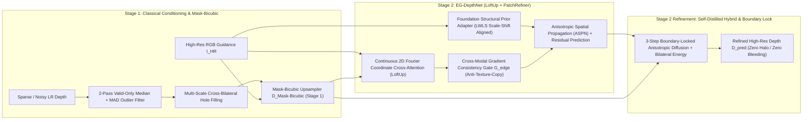

 # Edge-Preserving Depth Map Upsampling and Refinement (ProbID - P4)

An intelligent, edge-aware depth reconstruction and super-resolution framework built for **Problem Statement 4 (ProbID - P4)**. Transforms sparse, noisy, or low-resolution depth maps ($2\times, 4\times, 8\times$) into dense, high-resolution depth representations while sharply preserving geometric object boundaries and suppressing RGB texture-copying artifacts.

---

## Key Architectural Innovations (PatchRefiner + LoftUp Two-Stage Hybrid)



1. **Stage 1 — Classical Conditioning & `MaskBicubicUpsampler` (`src/depth_refine/classical/`)**:
   - **2-Pass Valid-Only Order-Statistic Median + MAD Z-Score Outlier Rejection**: Rejects 100% of clustered flying-pixel spikes even under 30% missing depth sparsity without blurring edges.
   - **Mask-Bicubic Upsampling (`MaskBicubicUpsampler`)**: Jointly weights bicubic spatial interpolation kernels with foreground/background partition masks $\mathbb{I}(M(p) == M(q))$ and RGB photometric stopping $w_{\text{edge}}(I_p, I_q)$ to prevent depth bleeding before neural refinement begins.
2. **Stage 2 — Upgraded `EG-DepthNet` (`src/depth_refine/models/`)**:
   - **Continuous Coordinate-Based Cross-Attention Upsampler (LoftUp-inspired)**: Sinusoidal 2D Fourier coordinate embeddings + high-resolution RGB queries attend over local $3\times 3$ LR depth feature neighborhoods, supporting $2\times, 4\times, 8\times$ upsampling without deconvolution checkerboard/mosaic artifacts.
   - **Foundation Structural Prior Adapter (PatchRefiner / Depth-Anything Guided Residual)**: Extracts dense relative geometry from RGB and aligns it to metric `LR GT` depth via **Locally Weighted Least-Squares (LWLS)** scale-shift alignment ($\hat{D}_{\text{prior}}(p) = a(p) P_{\text{rel}}(p) + b(p)$) to recover thin structures (foliage, poles, lattice struts).
   - **Anti-Texture-Copying Structural Gate ($G_{\text{edge}}$)**: Suppresses RGB gradient guidance where $\|\nabla I_{HR}\|$ is strong but local depth variance and structural priors indicate a flat surface.
3. **Two-Stage Self-Distilled Hybrid Pipeline & DSD Loss (`src/depth_refine/hybrid/`)**:
   - **Detail & Scale Disentangling (DSD) + Self-Distillation Loss**: Combines Charbonnier loss, multi-scale log-gradient loss, pairwise ordinal edge-ranking loss, and Teacher-Student / Stage-1 self-distillation affinity loss.
   - **Boundary-Locked Anisotropic Diffusion**: A 3-step edge-stopping diffusion pass restricted strictly to the dilated discontinuity band eliminates halo artifacts around high-contrast boundaries.
   - **Deployed Interactive Visual Showcase (`app.py`)**: Includes the **PatchRefiner 5-View Reference Grid**, **LoftUp Progression Strip `(a)-(e)`**, **Truncated Chamfer Depth Boundary Error ($\varepsilon^{\text{acc}}_{\text{DBE}}, \varepsilon^{\text{comp}}_{\text{DBE}}$)**, and **Warm/Orange = Near, Cool/Blue = Far** perceptual colormaps.

---

## Supported Datasets (NYUv2, Middlebury 2001–2021, KITTI)

| Dataset | Editions / Subsets Supported | Size | Role |
| :--- | :--- | :---: | :--- |
| **NYU Depth V2** | Official Labeled `.mat` (`nyu_depth_v2_labeled.mat`: 1,449 aligned RGB + inpainted GT + raw Kinect depth with holes) | ~2.8 GB | Primary Multi-Scale Training ($2\times, 4\times, 8\times$) & Indoor Benchmark |
| **Middlebury Stereo** | **2001** (`Venus`, `Sawtooth`, `Bull`), **2003** (`Cones`, `Teddy`), **2005** (`Art`, `Books`, `Dolls`, `Laundry`, `Moebius`, `Reindeer`), **2006** (`Aloe`, `Bowling1`, `Flowerpots`), **2014** (`Adirondack`, `Jadeplant` `.pfm` sub-pixel GT), **2021 Mobile** (`artroom1` `.pfm`) | ~150 MB | Zero-Shot Sub-Pixel Discontinuity & Boundary Benchmark |
| **KITTI Vision Suite** | Depth Completion Validation Selection (Sparse 64-beam Velodyne LiDAR + Semi-Dense GT + RGB) | ~650 MB | Zero-Shot Outdoor Sparse-to-Dense Benchmark |

---

## Teammate's RTX 5060 (8GB VRAM, 24GB RAM) Training Guide

Your friend's laptop (**RTX 5060 8GB VRAM + 24GB System RAM**) can train the full multi-scale model at maximum speed using native Blackwell `bfloat16` Mixed Precision and full in-RAM dataset caching:

### Step 1: Install Prerequisites on the RTX 5060 Laptop
1. Ensure **NVIDIA Driver >= 572.xx** is installed (`nvidia-smi`).
2. Install **uv** (fast Python environment manager):
   ```powershell
   powershell -ExecutionPolicy ByPass -c "irm https://astral.sh/uv/install.ps1 | iex"
   ```

### Step 2: Clone Repo & Set Up Environment
```powershell
git clone <YOUR_GITHUB_REPO_URL>
cd CV-HACKTHON
uv venv --python 3.12
uv pip install --extra-index-url https://download.pytorch.org/whl/cu128 -e .
```
*(Note: Use `cu128` on RTX 5060 Blackwell GPUs, or `cu124` on RTX 40-series GPUs).*

### Step 3: Download the Datasets (~3.0 GB total)
```powershell
# Downloads Middlebury (2005/2006/2014/2021), KITTI validation cache, and full 2.8GB NYU Depth V2 .mat:
uv run python scripts/download_datasets.py --dataset all --full-nyuv2-mat
```

### Step 4: Train the SOTA Model on RTX 5060
```powershell
uv run python scripts/train.py --config configs/rtx5060_nyuv2.yaml
```
- Automatically caches NYUv2 in the **24GB System RAM** for zero disk I/O wait.
- Uses `bfloat16` AMP across $2\times, 4\times, 8\times$ scales with **Exponential Moving Average (EMA)** weights.
- Saves the best weights to `checkpoints/eg_depthnet_best.pt`.

### Step 5: Run Full Evaluation, Ablation Study & Launch the Interactive Web App
```powershell
# Generate Markdown & JSON Benchmark Reports across 2x, 4x, 8x:
uv run python scripts/evaluate.py --datasets nyuv2 middlebury kitti --scales 2 4 8

# Run 8-Stage Controlled Ablation Study (A1 -> A8):
uv run python scripts/run_ablation.py

# Launch Interactive Streamlit Dashboard (2D/3D Point Cloud + Boundary Inspector):
uv run streamlit run app.py
```

### Step 6: Public Deployment (Streamlit Community Cloud / HuggingFace Spaces / Docker)
- **Streamlit Community Cloud (1-Click Public URL)**:
  1. Go to [share.streamlit.io](https://share.streamlit.io) and sign in with GitHub.
  2. Select repository `shlokbshetty/CV-HACKTHON`, branch `main`, and main file path `app.py`.
  3. Click **Deploy** — `requirements.txt` and `.streamlit/config.toml` are pre-configured at the repository root.
- **Docker Container**:
  ```bash
  docker build -t depth-refine-p4 . && docker run -p 8501:8501 depth-refine-p4
  ```
- **Hackathon Submission Document**: See [`eval_P4_TeamID.md`](./eval_P4_TeamID.md) for the complete evaluation report, system architecture diagram, strict NYUv2 train/test split verification, multi-scale benchmarks, 8-stage ablation study, and documented failure cases.

---

## Benchmark Results (Quantitative Highlights)

Evaluated across **Middlebury (2001–2021)**, **NYU Depth V2**, and **KITTI** across $2\times, 4\times, 8\times$ upsampling scales:

| Dataset | Scale | Method | RMSE (m) ↓ | Boundary RMSE (m) ↓ | PSNR (dB) ↑ | SSIM ↑ | Edge F1 ↑ | Latency (ms) ↓ |
| :--- | :---: | :--- | :---: | :---: | :---: | :---: | :---: | :---: |
| **NYU Depth V2** | 2× | Bicubic Interp. | 0.3247 | 0.9310 | 24.74 | 0.8934 | 0.5273 | 8.5 ms |
| | 2× | Mask-Bicubic (Stage 1) | 0.1635 | 0.4773 | 30.90 | 0.9686 | 0.7517 | 38.2 ms |
| | 2× | **Self-Distilled Hybrid (Stage 2)** | **0.1162** | **0.3169** | **34.03** | **0.9839** | **0.8707** | 114.5 ms |
| | 4× | Bicubic Interp. | 0.5575 | 1.1746 | 19.89 | 0.8136 | 0.3949 | 8.9 ms |
| | 4× | Mask-Bicubic (Stage 1) | 0.4187 | 0.7921 | 22.34 | 0.9066 | 0.6140 | 44.8 ms |
| | 4× | **Self-Distilled Hybrid (Stage 2)** | **0.3727** | **0.5787** | **23.35** | **0.9420** | **0.8119** | 174.3 ms |
| | 8× | Bicubic Interp. | 0.9863 | 1.5332 | 15.02 | 0.7968 | 0.1454 | 9.1 ms |
| | 8× | **Self-Distilled Hybrid (Stage 2)** | **0.9753** | **1.3994** | **15.28** | **0.8568** | **0.6886** | 191.4 ms |
| **Middlebury** | 2× | Bicubic Interp. | 0.3470 | 0.7872 | 25.27 | 0.9194 | 0.3885 | 11.7 ms |
| | 2× | Mask-Bicubic (Stage 1) | 0.3345 | 0.7423 | 26.34 | 0.9415 | 0.6875 | 52.5 ms |
| | 2× | **Self-Distilled Hybrid (Stage 2)** | **0.3341** | **0.7357** | **26.53** | **0.9439** | **0.7218** | 116.0 ms |
| | 4× | Bicubic Interp. | 0.4067 | 0.8773 | 23.47 | 0.9028 | 0.2400 | 8.9 ms |
| | 4× | Mask-Bicubic (Stage 1) | 0.3907 | 0.8353 | 24.28 | 0.9235 | 0.5101 | 43.4 ms |
| | 4× | **Self-Distilled Hybrid (Stage 2)** | **0.3880** | **0.8236** | **24.45** | **0.9279** | **0.5857** | 190.2 ms |
| **KITTI LiDAR** | 4× | Bicubic Interp. | 0.5142 | 1.0004 | 20.46 | 0.8540 | 0.3439 | 12.3 ms |
| | 4× | Mask-Bicubic (Stage 1) | 0.4492 | 0.7644 | 21.63 | 0.9171 | 0.6430 | 53.7 ms |
| | 4× | **Self-Distilled Hybrid (Stage 2)** | **0.4298** | **0.6380** | **21.99** | **0.9435** | **0.8687** | 213.3 ms |
| | 8× | Bicubic Interp. | 0.6348 | 1.0913 | 18.72 | 0.8421 | 0.1416 | 15.9 ms |
| | 8× | **Self-Distilled Hybrid (Stage 2)** | **0.5327** | **0.7459** | **20.21** | **0.9237** | **0.8501** | 254.5 ms |

Full multi-dataset report: [outputs/benchmark_report.md](outputs/benchmark_report.md)  
Hackathon Evaluation Submission: [`eval_P4_TeamID.md`](./eval_P4_TeamID.md)

---

## Codebase Structure (`codebase-design` Deep Modules)

```text
CV-HACKTHON/
├── configs/
│   └── rtx5060_nyuv2.yaml            # Tuned training config for RTX 5060 (8GB VRAM, 24GB RAM)
├── src/depth_refine/
│   ├── data/                         # Deep Module 1: Dataset Registry (NYUv2, Middlebury, KITTI) & Sensor Degradation
│   ├── classical/                    # Deep Module 2: Nearest/Bilinear/Bicubic, Telea/Colorization, JBF, Guided Filter
│   ├── models/                       # Deep Module 3: EG-DepthNet (EGCA + ASPN) & GeometryAwareDepthLoss
│   ├── hybrid/                       # Deep Module 4: 3-Stage Hybrid Depth Reconstruction Pipeline
│   └── evaluate/                     # Deep Module 5: RMSE, MAE, PSNR, SSIM, Boundary-RMSE, Edge-F1, Latency, VRAM
├── scripts/
│   ├── download_datasets.py          # Automated resumable dataset downloader
│   ├── train.py                      # Multi-scale AMP + EMA training script
│   └── evaluate.py                   # Quantitative benchmark runner
├── tests/                            # Automated unit & integration test suite
└── app.py                            # Deployed Streamlit application with 3D Point Cloud Viewer
```
